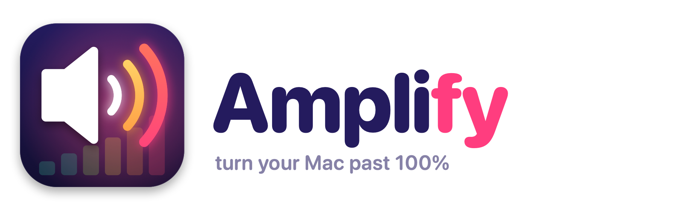

<p align="center">
  <picture>
    <source media="(prefers-color-scheme: dark)" srcset="assets/logo-dark.png">
    
  </picture>
</p>

<p align="center">
  A menu bar app that boosts your Mac's volume past 100%, with sound effects and a per-app mixer.
</p>

<p align="center">
  <a href="https://github.com/RishikeshSreekumar/amplify/releases/latest"></a>
  
  <a href="https://github.com/RishikeshSreekumar/amplify/actions/workflows/test.yml"></a>
  
  <a href="LICENSE"></a>
</p>

---

## Features

- **System-wide boost.** Makes everything louder, from 100% up to 300%: browser, Zoom, Music, games.
- **Volume keys past 100%.** At full volume, Volume Up keeps going into the boost, with an on-screen level display.
- **Sound effects.** Loudness, Voice Clarity, Auto-Level, Virtual Bass, Mono, stereo Width and Balance.
- **10-band equalizer.** Presets (Bass Boost, Treble Boost, Vocal, Loudness Curve) or your own curve.
- **Per-app mixer.** Give any app its own level from 0% (muted) to 300%. Chrome at 200%, Slack at 50%.
- **Remembers each output.** Speakers, headphones and AirPods each keep their own boost. New headphones start at 100%.
- **Built-in limiter.** Peaks are held just under full scale, so cranking it up doesn't clip harshly. Live level meters show it working.
- **Quick control.** Scroll over the menu bar icon to change the boost, right-click to turn it on or off.
- **No drivers.** Uses Core Audio process taps (macOS 14.2+). No kernel extension, no virtual audio device.
- **Safe by design.** If Amplify quits or crashes, your Mac's audio goes straight back to normal.

## Install

### Homebrew (recommended)

```sh
brew install --cask rishikeshsreekumar/tap/amplify
```

Then open **Amplify** from Applications or Spotlight. Look for the speaker icon in your menu bar.

Update with `brew upgrade --cask amplify`.

### Download

1. Download **Amplify-x.y.dmg** from the [latest release](https://github.com/RishikeshSreekumar/amplify/releases/latest).
2. Open it and drag **Amplify** onto **Applications**.
3. Open Amplify from Applications.

> **"Amplify can't be opened" / "Apple could not verify…"?**
> Amplify isn't signed with a paid Apple Developer certificate yet, so macOS asks you to confirm the first time. Pick one:
>
> - Open **System Settings → Privacy & Security**, scroll down and click **Open Anyway** next to Amplify. Then open it again.
> - Or run this once in Terminal:
>   ```sh
>   xattr -dr com.apple.quarantine /Applications/Amplify.app
>   ```
>
> Homebrew installs handle this for you.

### Build from source

Needs the Xcode Command Line Tools (`xcode-select --install`).

```sh
git clone https://github.com/RishikeshSreekumar/amplify.git
cd amplify
./build.sh --install
```

## Using it

Click the Amplify icon in the menu bar to open the panel:

| Section | What's there |
|---|---|
| **Header** | On/off switch and the current output device |
| **Meters** | Input and output levels, and how hard the limiter is working |
| **Boost** | 100% to 300% slider, plus 125–300% presets |
| **Effects** | Loudness, Voice Clarity, Auto-Level, Virtual Bass (with amount), Mono, Width, Balance |
| **Equalizer** | Preset menu and ten bands from 32 Hz to 16 kHz, ±12 dB. Dragging a band switches to Custom |
| **Apps** | A level slider for every app using audio. The ↺ button puts an app back to 100% |
| **Settings** | Volume keys past 100%, Remember boost per output, Open at Login |

Shortcuts on the menu bar icon:

- **Scroll** to change the boost in 5% steps.
- **Right-click** (or Control-click) to turn Amplify on or off.

While Amplify is on, the icon shows the boost level next to it. When it's off, the icon is dimmed.

### Effects

| Effect | What it does |
|---|---|
| **Loudness** | A compressor: quiet parts come up, loud parts are held back. Sounds louder than plain boost with less distortion. Great for films |
| **Voice Clarity** | Cuts low rumble and lifts the 3 kHz range where speech sits. For calls, podcasts and lectures |
| **Auto-Level** | Slowly evens out volume jumps between videos, ads and apps (up to +12 dB / −6 dB) |
| **Virtual Bass** | Small speakers can't play deep bass, so this adds harmonics your ear hears as bass |
| **Mono** | Same sound in both ears. Handy with one AirPod in |
| **Width** | Narrows or widens the stereo image |
| **Balance** | Shifts sound left or right |

### Volume keys

Turn on **Settings → Volume keys go past 100%**. When your Mac's volume is already at maximum, Volume Up raises the boost in 10% steps (turning Amplify on if needed), and Volume Down lowers the boost before it lowers the system volume. A level display appears like the normal volume one.

This needs **Accessibility** permission. macOS asks the first time you turn it on.

### Permission

The first time you turn boost on, macOS asks to let Amplify record **system audio**. Amplify needs this to capture what your Mac is playing before making it louder. Nothing is saved or sent anywhere.

If you clicked **Don't Allow**, turn Amplify on under **System Settings → Privacy & Security → Screen & System Audio Recording → System Audio Recording Only**.

Because Amplify is ad-hoc signed, macOS may ask again (for both permissions) after an update.

## Things to know

- **Louder means less headroom.** Already-loud audio can't get much louder without distortion. The limiter keeps it clean-ish, but small laptop speakers will sound strained at high boost. Boost works best on quiet videos, calls and podcasts.
- **One output.** While Amplify is on, all audio plays on your current default output device, even from apps set to use a different one.
- **App levels and audio blips.** Giving an app its own level (or putting it back to 100%) rebuilds the audio capture, which causes a brief gap in sound. So does an app with its own level starting a new audio process (browsers do this when a tab starts playing).
- **Tiny delay.** Routing audio through Amplify adds a few milliseconds of latency.

## Uninstall

```sh
brew uninstall --cask amplify          # add --zap to also remove settings
```

Or quit Amplify from its menu and move it from Applications to the Bin.

## How it works

macOS caps every app at 100% volume. Amplify works around that with [Core Audio process taps](https://developer.apple.com/documentation/coreaudio/capturing-system-audio-with-core-audio-taps), added in macOS 14.2:

1. A global **process tap** captures every app (except Amplify, and apps with their own level) and mutes the originals while it's being read. Each app with its own level gets a **separate tap**, so it can be mixed at a different gain.
2. A private **aggregate device** combines the taps with your current output device, so they all share one clock.
3. Amplify's audio callback mixes the taps (each at its own level), then runs the effects chain: EQ → voice clarity → virtual bass → stereo width and balance → auto-level → loudness compressor → boost → peak limiter (instant attack, 250 ms release, −1 dBFS ceiling).

The taps use `mutedWhenTapped`, so the original audio is only muted while Amplify is actively reading it. If Amplify stops for any reason, sound returns at normal volume.

Settings changes reach the audio thread through a lock it only ever *tries*, so the audio callback never waits or allocates memory.

## Development

```sh
./build.sh                # build Amplify.app (universal binary)
./build.sh --install      # build, copy to /Applications and relaunch
swift assets/make_art.swift assets   # regenerate icon + logos
VERSION=2.1 ./release.sh  # package, publish GitHub release, update Homebrew tap
```

| File | What's in it |
|---|---|
| [`Sources/main.swift`](Sources/main.swift) | Menu bar icon, panel, scroll and right-click |
| [`Sources/PanelView.swift`](Sources/PanelView.swift) | The panel UI (SwiftUI) |
| [`Sources/AppModel.swift`](Sources/AppModel.swift) | Settings, per-device memory, per-app levels, volume key logic |
| [`Sources/AudioEngine.swift`](Sources/AudioEngine.swift) | Taps, aggregate device, device and process tracking |
| [`Sources/DSP.swift`](Sources/DSP.swift) | The real-time effects chain and limiter |
| [`Sources/AppAudio.swift`](Sources/AppAudio.swift) | Which apps are using audio (helper processes folded into their app) |
| [`Sources/VolumeKeys.swift`](Sources/VolumeKeys.swift), [`Sources/HUD.swift`](Sources/HUD.swift) | Volume key handling and the on-screen level display |

The icon and logo are drawn in code by [`assets/make_art.swift`](assets/make_art.swift).

### Tests

```sh
tests/run.sh dsp    # offline: every effect checked against synthetic signals, no audio hardware
tests/run.sh e2e    # end to end: measures the installed app's real output
tests/run.sh        # both
```

- **`dsp`** feeds sine waves, square waves and noise through the audio processor and checks the output: exact boost levels, the limiter ceiling, per-app mixing, EQ band gains, voice clarity, virtual bass harmonics, stereo, auto-level, the compressor curve, and that everything maxed out never clips or produces NaNs. Runs in CI on every push.
- **`e2e`** relaunches Amplify with different settings, plays a test tone and uses two process taps to measure the tone and Amplify's output side by side. The ratio is the real gain through the whole pipeline. Taps read audio before the device volume, so your volume setting doesn't affect the result. The first run asks you to allow System Audio Recording for **Amplify Test**. Your settings are restored afterwards. Set `APP=./Amplify.app` to test a local build.

## License

[MIT](LICENSE)
